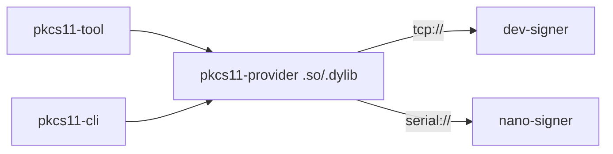

# PQC Development HSM (Development Phase)

A PKCS#11 token for developing and testing integration code before deploying against a production HSM. Supports the post-quantum signature SLH-DSA (ML-DSA soon to come). Run it as a Docker container for local development or flash it to an Arduino Nano ESP32 where the private key stays on the device. 


## Dependencies

- This repository is forked from [`slh-dsa-signer`](https://github.com/mourningdove007/slh-dsa-signer), which is where `nano-signer/`, `slh-dsa-hw/`, and `cli/` originated and were benchmarked.
- `slh-dsa` (`0.1.0`, unmodified, from crates.io), RustCrypto's [reference implementation](https://github.com/RustCrypto/signatures/tree/master/slh-dsa), is used by both `cli/` and `dev-signer/`; `dev-signer/` is a software-only target, so it has no reason to depend on the hardware-oriented `slh-dsa-hw` fork instead.
- `nano-signer/` signs using `slh-dsa-hw` (`../slh-dsa-hw`), a local fork of RustCrypto's `slh-dsa` (`0.2.0-rc.5`) that adds an ESP32-S3 hardware SHA backend; see `slh-dsa-hw/README.md` for what changed and why.
- Software hashing (`slh-dsa-hw`'s software path) uses RustCrypto's [`sha2`](https://crates.io/crates/sha2) and [`hmac`](https://crates.io/crates/hmac) crates.
- `pkcs11-provider/` uses [`cryptoki-sys`](https://crates.io/crates/cryptoki-sys) for the PKCS#11 C ABI type definitions, and [`serialport`](https://crates.io/crates/serialport) (with its `libudev`-dependent USB-enumeration feature turned off, since this provider only ever opens an explicitly-named port) to talk to `nano-signer`.


## Hardware & build

| Field | Value |
|---|---|
| Board | Arduino Nano ESP32 |
| Chip | ESP32-S3 (u-blox NORA-W106 module) |
| CPU | Xtensa LX7 dual-core @ 240 MHz (max, via `CpuClock::max()`) |
| RAM | 512 KB SRAM |
| Flash | 16 MB |
| Build profile | `release` (`opt-level = "s"`, `lto = "fat"`, `codegen-units = 1`; overflow checks and debug assertions off) |
| Hashing | Hardware rows: ESP32-S3 SHA hardware accelerator via the `slh-dsa-hw` fork's `hw-sha` feature (on by default, all six parameter sets). Software rows: RustCrypto `sha2` only, no hardware |

## SLH-DSA Benchmarks: Hardware vs Software

| Param | Backend | Unit | Min | Max | Average |
|---|---|---|---|---|---|
| 128f | software | ms | 2989 | 3048 | 2997 |
| 128f | hardware | ms | 1010 | 1028 | 1012 |
| 128s | software | ms | 62263 | 62322 | 62272 |
| 128s | hardware | ms | 21061 | 21079 | 21063 |
| 192f | software | ms | 76807 | 83095 | 77573 |
| 192f | hardware | ms | 1708 | 1726 | 1710 |

## Raw hashing: hardware vs software

| Algorithm | Backend | Unit | Min | Max | Average |
|---|---|---|---|---|---|
| SHA-256 | software | µs | 47 | 94 | 69 |
| SHA-256 | hardware | µs | 8 | 35 | 10 |
| <span style="color:red">SHA-512</span> | <span style="color:red">software</span> | <span style="color:red">µs</span> | <span style="color:red">6061</span> | <span style="color:red">12036</span> | <span style="color:red">11317</span> |
| SHA-512 | hardware | µs | 9 | 35 | 11 |


See [BENCHMARKING.md](https://github.com/mourningdove007/slh-dsa-signer/blob/main/BENCHMARKING.md) for what these measure and how they were produced. <span style="color:red">We plan to investigate why the software SHA-512 takes so long on the Nano device.</span>


## Communication Between Components

Two possible clients load the same provider. The provider talks to one of two interchangeable token backends over `token-core`'s wire protocol, picked by `PQC_HSM_ENDPOINT`.



## Directory map

| Path | What it is | Depends on / talks to |
|---|---|---|
| `cli/` | local keygen/sign/verify | `slh-dsa` (crates.io); standalone |
| `token-core/` | Shared wire protocol: frames, `Command`/`Status`, `dispatch()` | no deps; used by `dev-signer`, `nano-signer`, `pkcs11-provider` |
| `slh-dsa-hw/` | Local fork of RustCrypto `slh-dsa` adding ESP32-S3 hardware SHA | used only by `nano-signer` |
| `dev-signer/` | Software token, plain `slh-dsa`, listens over TCP | `token-core`, `slh-dsa`; a backend `pkcs11-provider` can talk to |
| `nano-signer/` | Firmware token for the Arduino Nano ESP32; private key never leaves the device | `token-core`, `slh-dsa-hw`; a backend `pkcs11-provider` can talk to, over serial |
| `pkcs11-provider/` | PKCS#11 C ABI module (`cdylib`) (the actual HSM interface) | `token-core` (wire protocol), `cryptoki-sys`; bridges PKCS#11 calls to whichever backend `PQC_HSM_ENDPOINT` names |
| `pkcs11-cli/` | Minimal standalone PKCS#11 client for the two things `pkcs11-tool` can't do (read a vendor-defined pubkey, generate a keypair with a vendor mechanism) | loads `pkcs11-provider`'s built `.so`/`.dylib` directly, same as `pkcs11-tool` does |


## Desktop CLI (`cli/`)

A desktop prototype of the signing logic. `keygen`, `sign`, and `verify` all support the same six FIPS 205 SLH-DSA-SHA2 parameter sets via `--param`. Run all commands from the `cli/` directory.

### Generate a keypair

```bash
cargo run -- keygen <secret-key-path> [--param 128s|128f|192s|192f|256s|256f] [--pub-key <public-key-path>]
```

Writes the raw secret key to `<secret-key-path>`, and always prints the public (verifying) key as hex to stdout. Pass `--pub-key <public-key-path>` to also write the raw public key bytes to disk.

`--param` on `keygen` defaults to `SLH-DSA-SHA2-128s`, the most conservative choice. The same pattern `sign` and `verify` below now use too.

### Sign a message

```bash
cargo run -- sign <secret-key-path> <message> <signature-path> [--param 128s|128f|192s|192f|256s|256f]
```

Reads the secret key from `<secret-key-path>`, writes the raw signature over `<message>` to `<signature-path>`, and prints the hex-encoded signature to stdout.

### Verify a signature

```bash
cargo run -- verify <public-key-path> <message> <signature-path> [--param 128s|128f|192s|192f|256s|256f]
```

### Run tests

```bash
cargo test
```


## Dev Software Token

`dev-signer` is a software-only token (TCP, plain `slh-dsa`). Ships with a demo `192f` keypair at `dev-signer/keys/`. Generates its own keypair on startup, the same way a real HSM provisions itself on first boot.

### 1. Run the Token

```bash
cd dev-signer
cargo run
```

or with Docker

```bash
cd dev-signer
docker compose up --build
```

Listens on `tcp://127.0.0.1:7878` by default (`PORT` env var to change it). To start from a self-generated keypair instead of the checked-in demo one, point `SEC_KEY_PATH`/`PUB_KEY_PATH` at paths that don't exist yet:

```bash
SEC_KEY_PATH=keys/my-sec.key PUB_KEY_PATH=keys/my-pub.key PARAM_SET=192f cargo run
```

### 2. Point the Provider

```bash
export PQC_HSM_ENDPOINT=tcp://127.0.0.1:7878
```


## Hardware Token

Same flow on the Arduino Nano ESP32 (`nano-signer/`), signing with the ESP32-S3 hardware SHA accelerator. The private key never leaves the device. On first boot with no key stored yet, it generates its own keypair and persists it to a dedicated flash partition, the same way `dev-signer` self-provisions its key files. No `cli keygen` step needed.


### 1. Build

Parameter set is a compile-time feature; exactly one must be enabled.

```bash
cd nano-signer
cargo build --release --no-default-features --features param-192f
```

| Feature | Parameter set |
|---|---|
| `param-128s` | SLH-DSA-SHA2-128s |
| `param-128f` | SLH-DSA-SHA2-128f |
| `param-192s` | SLH-DSA-SHA2-192s |
| `param-192f` (default) | SLH-DSA-SHA2-192f |
| `param-256s` | SLH-DSA-SHA2-256s |
| `param-256f` | SLH-DSA-SHA2-256f |

### 2. Flash

```bash
espflash flash --monitor --partition-table partitions.csv target/xtensa-esp32s3-none-elf/release/nano-signer
```

### 3. Point the Provider

```bash
export PQC_HSM_ENDPOINT=serial:/dev/cu.usbmodem1101:115200  # path varies by OS/board
```


## Provider

`pkcs11-provider` is the PKCS#11 module that talks to whichever token `PQC_HSM_ENDPOINT` points at ([Dev Software Token](#dev-software-token) or [Hardware Token](#hardware-token)).

### 1. Build

```bash
cd pkcs11-provider
cargo build --release
```

Produces `target/release/libpkcs11_provider.so` (`.dylib` on macOS, `.dll` on Windows).

### 2. Check the Key Exists

```bash
pkcs11-tool --module target/release/libpkcs11_provider.dylib --list-slots
pkcs11-tool --module target/release/libpkcs11_provider.dylib --list-objects
```

### 3. Sign a Message

```bash
MESSAGE="hello from pqc-dev-hsm"
echo -n "$MESSAGE" > /tmp/msg.txt

pkcs11-tool --module target/release/libpkcs11_provider.dylib \
  --sign --mechanism 0x80000001 --id 01 \
  --input-file /tmp/msg.txt --output-file /tmp/sig.bin
```

`0x80000001` is the provider's one mechanism (`CKM_SLH_DSA_SHA2_VENDOR`); `--id 01` is its one private key.

### 4. Verify It

Both tokens generate their own key rather than using a fixed, checked-in one (see [Dev Software Token](#dev-software-token) / [Hardware Token](#hardware-token)), so read the public key back from the token itself instead of assuming a file on disk matches whatever key is actually active.

`pkcs11-tool` can't do this part: `--read-object --type pubkey` only knows how to format standard key types (`CKK_RSA`, `CKK_EC`, ...), and this provider reports its SLH-DSA key as `CKK_VENDOR_DEFINED`, so `pkcs11-tool` refuses before it even reads `CKA_VALUE`. Use `pkcs11-cli` (`pkcs11-cli/`) instead. It's a minimal standalone PKCS#11 client that just does `C_FindObjects` + `C_GetAttributeValue` without the format-specific logic:

```bash
cd ../pkcs11-cli
cargo build --release
./target/release/pkcs11-cli get-pubkey \
  --module ../pkcs11-provider/target/release/libpkcs11_provider.dylib \
  --id 01 --output /tmp/pub.key

cd ../cli
cargo run -- verify /tmp/pub.key "$MESSAGE" /tmp/sig.bin --param 192f
```

Match `--param` to whichever token you signed against: `192f` for `dev-signer`'s default (override with `PARAM_SET`), or whatever `--param`/feature you built `nano-signer` with.

### 5. Generate a New Key Pair

A real HSM lets a client provision a new key on demand, not just rely on whatever key existed at boot.

`pkcs11-tool --keypairgen` can't drive this either: it picks its generation mechanism from `--key-type`'s lookup table (RSA, EC, ...), which has no vendor-defined entry, so it ignores `--mechanism 0x80000001` and sends the wrong one. The provider correctly rejects it with `CKR_MECHANISM_INVALID`. Use `pkcs11-cli` again, same as step 4:

```bash
cd ../pkcs11-cli
./target/release/pkcs11-cli generate-keypair \
  --module ../pkcs11-provider/target/release/libpkcs11_provider.dylib \
  --output /tmp/pub.key
```

This replaces the token's one key pair and writes its public key to `/tmp/pub.key`.
